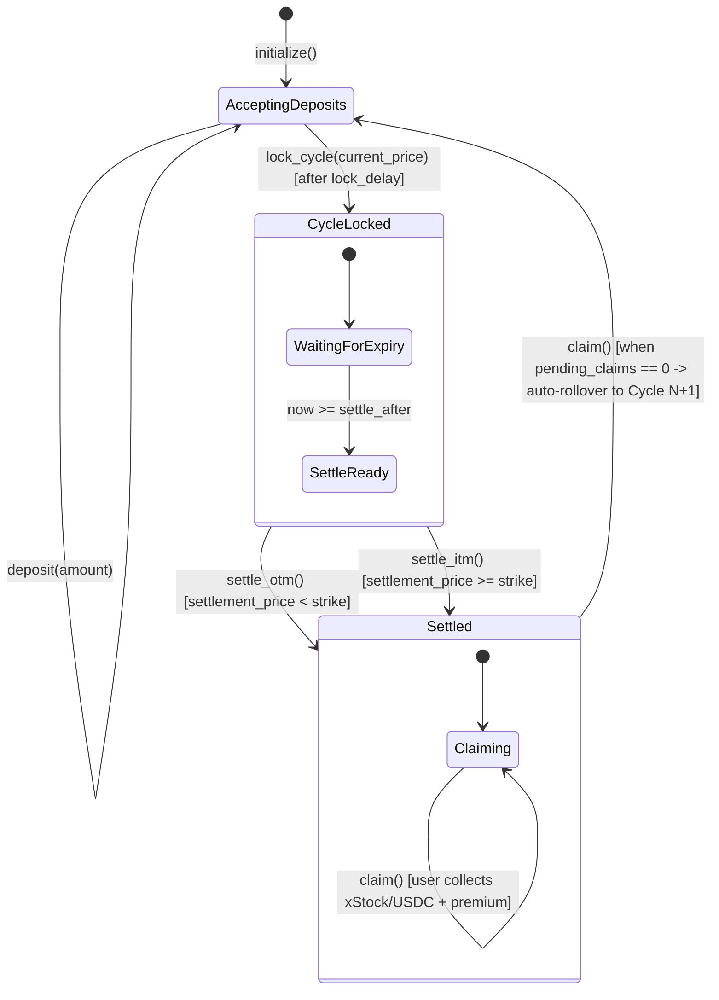

# 🌾 Harvest Protocol — Backend Architecture & Technical Specification

> **Status:** Live & Verified on Solana Devnet  
> **Program ID:** `34Y7acmqWosmkfPJjqRUQzrHFdxmxpQezLSvgD9bLJJo`  
> **Authority / Deployer:** `8rWcPxsewwif7UeHea2W8fUEuDDvUVSERoQyhXoMnRVV`  
> **Deployment Cluster:** Solana Devnet (`https://api.devnet.solana.com`)  
> **Canonical IDL:** `idl/harvest.json`

---

## 1. Executive Summary

**Harvest** is an automated covered-call yield protocol on Solana engineered specifically for **xStocks** (synthetic US equities including xNVDA, xTSLA, and xAAPL issued under the Token-2022 standard).

Users deposit their xStock tokens into weekly vault cycles. In return, depositors receive guaranteed weekly yield paid in **USDC premium**. At cycle expiration:
- **Out-of-the-Money (OTM):** If the equity price stays below the strike price, depositors receive 100% of their deposited xStock back **plus** their USDC premium.
- **In-the-Money (ITM):** If the equity price exceeds the strike, the underlying xStock is converted to USDC at the locked strike price, and depositors receive their full USDC value **plus** their USDC premium.
- **Perpetual Auto-Rollover:** As soon as all active depositors claim their proceeds (`pending_claims == 0`), the on-chain program automatically increments `current_cycle`, clears strike parameters, and resets the state to `AcceptingDeposits` for the next week.

---

## 2. On-Chain State Machine & Vault Lifecycle



### Cycle Phase Transitions & Timing Logic

| State | Who Triggers | Preconditions & Timers | State Changes |
|---|---|---|---|
| **`AcceptingDeposits`** | Users / Keepers | Vault is open; `current_cycle` active. | Users can call `deposit()` anytime before lock. |
| **`CycleLocked`** | Keeper (Authority) | `Clock::now >= cycle_locked_at + LOCK_DELAY` (Devnet: 10s; Mainnet: 48h). | Strikes locked; `settle_after = now + cycle_duration_seconds`. No further deposits allowed. |
| **`Settled` (OTM)** | Keeper (Authority) | `Clock::now >= settle_after` AND `settlement_price < strike_price`. | Vault marked OTM; xStock returned to users upon claim. |
| **`Settled` (ITM)** | Keeper (Authority) | `Clock::now >= settle_after` AND `settlement_price >= strike_price`. | Keeper swaps xStock → USDC; deposits proceeds into `vault_usdc_ata`. |
| **`Claimed / Rollover`** | Depositors | Vault is in `Settled` state; user calls `claim()`. | Each user gets tokens + premium. When `pending_claims == 0`, vault auto-increments to `current_cycle + 1` and returns to `AcceptingDeposits`. |

---

## 3. Deployed Accounts & Key Addresses

### Program & Administrative Keys

| Name | Address | Description |
|---|---|---|
| **Harvest Program ID** | `34Y7acmqWosmkfPJjqRUQzrHFdxmxpQezLSvgD9bLJJo` | Executable on-chain Anchor program |
| **Authority / Fee Payer** | `8rWcPxsewwif7UeHea2W8fUEuDDvUVSERoQyhXoMnRVV` | Program upgrade authority & keeper bot signer |

### Token Mints & Standard

| Asset | Cluster | Mint Address | Standard | Decimals | Notes |
|---|---|---|---|---|---|
| **Devnet USDC** | Devnet | `Gh9ZwEmdLJ8DscKNTkTqPbNwLNNBjuSzaG9Vp2KGtKJr` | SPL Token | 6 | Circle Official Devnet Faucet Mint |
| **Coinbase Devnet USDC** | Devnet | `4zMMC9srt5Ri5X14GAgXhaHii3GnPAEERYPJgZJDncDU` | SPL Token | 6 | Alternative devnet USDC mint |
| **Mainnet USDC** | Mainnet | `EPjFWdd5AufqSSqeM2qN1xzybapC8G4wEGGkZwyTDt1v` | SPL Token | 6 | Canonical Circle USDC |
| **Devnet Test xStock** | Devnet | `EM5uTvQNpeTt4P1vRyfRdvtku42MytZjRsPG7KG4BRqV` | Token-2022 | 8 | Active test mint verified on devnet |
| **xNVDA (NVIDIA)** | Mainnet | `Xsc9qvGR1efVDFGLrVsmkzv3qi45LTBjeUKSPmx9qEh` | Token-2022 | 8 | Synthetic NVDA equity |
| **xTSLA (Tesla)** | Mainnet | `XsDoVfqeBukxuZHWhdvWHBhgEHjGNst4MLodqsJHzoB` | Token-2022 | 8 | Synthetic TSLA equity |
| **xAAPL (Apple)** | Mainnet | `XsbEhLAtcf6HdfpFZ5xEMdqW8nfAvcsP5bdudRLJzJp` | Token-2022 | 8 | Synthetic AAPL equity |

### On-Chain Program Derived Addresses (PDAs)

```
VaultConfig PDA:
  Seeds: [b"vault_config", xstock_mint.key().as_ref()]
  Program: 34Y7acmqWosmkfPJjqRUQzrHFdxmxpQezLSvgD9bLJJo

UserPosition PDA:
  Seeds: [b"position", vault_config.key().as_ref(), user_owner.key().as_ref(), current_cycle.to_le_bytes().as_ref()]
  Program: 34Y7acmqWosmkfPJjqRUQzrHFdxmxpQezLSvgD9bLJJo
```

| Entity | Address (Devnet NVDA Vault) | Type / Owner |
|---|---|---|
| **VaultConfig PDA** | `Gm2yabt5fCMBE6QpYjmt9hEY8nizYMdhqXc9moPG44Qz` | Program-owned state account (260 bytes) |
| **Vault xStock ATA** | Derived via Associated Token Program | Owned by `VaultConfig PDA` (Token-2022) |
| **Vault USDC ATA** | `9pwWgZdwD44fzTFh4H7vdUwRmtEhGmVgJcNhAVV7BurP` | Owned by `VaultConfig PDA` (Holds USDC reserve) |
| **UserPosition PDA (Cycle 1)** | `6joLMAQEqu5ngbEBu9yxmsD38tUTGXQDoThFRZK8PMtG` | Program-owned position account (106 bytes) |

---

## 4. Program Account Structures

### 1. `VaultConfig` (260 Bytes)

Stores protocol parameters, active cycle status, price checkpoints, and reserve bookkeeping for a single xStock asset.

```rust
pub struct VaultConfig {
    pub authority: Pubkey,                  // 32: Admin / Keeper authorized to lock & settle
    pub xstock_mint: Pubkey,                // 32: Token-2022 equity mint
    pub ticker: [u8; 8],                    //  8: ASCII ticker symbol (e.g. "NVDA\0\0\0\0")
    pub xstock_decimals: u8,                //  1: Decimals of xStock (8 for real xStocks)
    pub usdc_mint: Pubkey,                  // 32: USDC mint (6 decimals)
    pub vault_xstock_ata: Pubkey,           // 32: Vault Token-2022 account for xStock
    pub vault_usdc_ata: Pubkey,             // 32: Vault SPL Token account for USDC reserve
    pub strike_offset_bps: u16,             //  2: Basis points above market for strike (e.g. 300 = +3%)
    pub premium_rate_bps: u16,              //  2: Weekly yield basis points (e.g. 150 = 1.5%)
    pub current_cycle: u64,                 //  8: Monotonically increasing cycle counter (1, 2, 3...)
    pub cycle_state: CycleState,            //  1: AcceptingDeposits (0), CycleLocked (1), Settled (2)
    pub strike_price: i64,                  //  8: Strike price in PRICE_PRECISION (6 decimals)
    pub settlement_price: i64,              //  8: Final settlement price at expiry
    pub was_otm: bool,                      //  1: True = OTM (tokens returned), False = ITM (cash)
    pub itm_usdc_proceeds: u64,             //  8: Total USDC collected from Jupiter swap if ITM
    pub cycle_locked_at: i64,               //  8: Unix timestamp when cycle opened / locked
    pub settle_after: i64,                  //  8: Unix timestamp after which settlement is valid
    pub cycle_duration_seconds: i64,        //  8: Duration of locked cycle (e.g. 60s test / 604800s prod)
    pub total_xstock_deposited: u64,        //  8: Total xStock base units locked in current cycle
    pub pending_claims: u64,                //  8: Count of depositors who have not yet claimed
    pub total_premium_distributed: u64,     //  8: Cumulative lifetime USDC premium paid out
    pub bump: u8,                           //  1: PDA bump seed
}
```

### 2. `UserPosition` (106 Bytes)

Tracks an individual user's stake and claim status for a specific vault cycle.

```rust
pub struct UserPosition {
    pub owner: Pubkey,                      // 32: Depositor wallet pubkey
    pub vault: Pubkey,                      // 32: Associated VaultConfig PDA
    pub cycle: u64,                         //  8: Cycle number this deposit belongs to
    pub xstock_amount: u64,                 //  8: Deposited base units (>= 100_000_000)
    pub deposit_value_usd: u64,             //  8: USD value at lock time (6 decimals)
    pub premium_earned_usdc: u64,           //  8: Premium allocated at claim time
    pub state: PositionState,               //  1: Active (0), Claimed (1)
    pub bump: u8,                           //  1: PDA bump seed
}
```

---

## 5. Instructions Specification

### `1. initialize`
- **Purpose:** Admin initializes a new vault for a specific xStock mint.
- **Parameters:**
  - `ticker: [u8; 8]` (e.g. `"NVDA\0\0\0\0"`)
  - `strike_offset_bps: u16` (max `2000` = 20%)
  - `premium_rate_bps: u16` (max `1000` = 10%)
  - `cycle_duration_seconds: i64` (e.g. `60` for fast devnet testing, `604800` for 7-day mainnet)
- **Account Layout:**
  1. `authority: Signer` (mut)
  2. `xstock_mint: InterfaceAccount<Mint>`
  3. `usdc_mint: InterfaceAccount<Mint>`
  4. `vault_config: Account<VaultConfig>` (init, seeds: `[b"vault_config", xstock_mint]`)
  5. `vault_xstock_ata: InterfaceAccount<TokenAccount>` (owned by `vault_config`)
  6. `vault_usdc_ata: InterfaceAccount<TokenAccount>` (owned by `vault_config`)
  7. `token_program: Program<Token2022>`
  8. `token_program_classic: Program<Token>`
  9. `system_program: Program<System>`
  10. `rent: Sysvar<Rent>`

---

### `2. deposit`
- **Purpose:** User deposits xStock tokens into the vault for the current cycle.
- **Requirements:**
  - `amount >= MIN_DEPOSIT_AMOUNT` (`100_000_000` base units = 1.0 token at 8 decimals).
  - Vault must be in `AcceptingDeposits` state.
  - Uses Token-2022 `transfer_checked` CPI (mandatory for Token-2022 extensions).
- **Account Layout:**
  1. `owner: Signer` (mut)
  2. `vault_config: Account<VaultConfig>` (mut)
  3. `xstock_mint: InterfaceAccount<Mint>`
  4. `user_xstock_ata: InterfaceAccount<TokenAccount>` (mut)
  5. `vault_xstock_ata: InterfaceAccount<TokenAccount>` (mut)
  6. `user_position: Account<UserPosition>` (init, seeds: `[b"position", vault, owner, cycle]`)
  7. `token_program: Program<Token2022>`
  8. `system_program: Program<System>`

---

### `3. lock_cycle`
- **Purpose:** Keeper records the current Pyth/market price and sets the fixed OTM strike.
- **Math:**
  $$\text{strike\_price} = \text{current\_price} \times \left(1 + \frac{\text{strike\_offset\_bps}}{10000}\right)$$
  $$\text{settle\_after} = \text{Clock::now} + \text{cycle\_duration\_seconds}$$
- **State Transition:** `AcceptingDeposits` $\rightarrow$ `CycleLocked`

---

### `4. settle_otm`
- **Purpose:** Keeper settles cycle when market price stays below strike at expiration.
- **Requirements:**
  - `Clock::now >= vault.settle_after`
  - `settlement_price < vault.strike_price`
- **State Transition:** `CycleLocked` $\rightarrow$ `Settled` (`was_otm = true`)

---

### `5. settle_itm`
- **Purpose:** Keeper settles cycle when market price breached strike (called away).
- **Requirements:**
  - Keeper swapped vault xStock tokens for USDC via Jupiter off-chain.
  - Transferred `usdc_proceeds` into `vault_usdc_ata`.
- **State Transition:** `CycleLocked` $\rightarrow$ `Settled` (`was_otm = false`)

---

### `6. claim`
- **Purpose:** Depositor withdraws their payout and USDC yield.
- **Payout Computation:**
  $$\text{deposit\_value\_usd} = \frac{\text{xstock\_amount} \times \text{strike\_price}}{10^{\text{xstock\_decimals}}}$$
  $$\text{premium\_usdc} = \frac{\text{deposit\_value\_usd} \times \text{premium\_rate\_bps}}{10000 \times \text{PRICE\_PRECISION}} \times 10^6$$
  - **If OTM:** User receives `xstock_amount` returned via Token-2022 `transfer_checked` + `premium_usdc`.
  - **If ITM:** User receives proportional share of `itm_usdc_proceeds` + `premium_usdc`.
- **Rollover Trigger:**
  - Decrements `pending_claims`.
  - If `pending_claims == 0`:
    - `current_cycle += 1`
    - `cycle_state = AcceptingDeposits`
    - Strike/settlement prices reset to 0.

---

## 6. Verified On-Chain Transaction Ledger

All core operations have been executed and confirmed on Solana Devnet:

| Action | Cluster | Tx Signature / Account | Status |
|---|---|---|---|
| **Program Deploy** | Devnet | `5k9zEVHR4yaLden5CxXKDKuD22M7gSxmzbXFdXQJyjvu39RPD6NViJK9wXdNRLwgzwPcDX8aVEXCH3rYJNyKwwYX` | Confirmed |
| **USDC Reserve Seed (500 USDC)** | Devnet | `4iGLKidV77gMkrAV6dbNZcUfkCEunNyiNcpwLTxjX4qaEWf2iHzPMd4rdq8nLdn6EiD8bfwDE174FuZfwrU81e2C` | Confirmed |
| **Vault Initialization** | Devnet | `G5L9VH6EZTnEgP9iBFuW679ekmCV8VEWNkaUW8Uo6dL9wj2qBiP2Dpdd9BTXqGu8gffvZcWD1W8HQiMUHhuMcYr` | Confirmed |
| **xStock Deposit (1.0 Token)** | Devnet | `3oVZP3zWjjiC6jsQes3R9KArEwZKru9HZM9c8HMLHwacyzBn9tkmDZ5pQRzEFRSoPXmWKn52Nf4amykrhjd7wKMj` | Confirmed |
| **Cycle 1 Lock ($197.33 Strike)** | Devnet | `3nf5mrxM9SQwNyKcHA6wJ48di1gXpZEXqzAzD6k6vLWWCyNU7TdmdHMJ5fa1nR65Hwrg6ePHDFfVvzJef9dDqoHj` | Confirmed |
| **Cycle 1 Settle OTM** | Devnet | `5wJaSBYp2Fd69kwqwp1At6n8vdTaRpvtQHvojGBp1MdwgC6wPmHe8zn4q39cK7oNmzk5KyavtHfaAf1kzQrSk6YY` | Confirmed |
| **Cycle 1 Claim (2.85 USDC Yield)** | Devnet | `5tTm8F5UiytsAJWzHwtdpP4raMkEVhatZgwD75s3frZRFdZGgsos7JKMTnbPBALKDFbo9aEdggfNrVrCxpias9rC` | Confirmed |
| **Keeper Cycle 2 Lock ($220.32 Strike)** | Devnet | `2pMaW8KFxzceMUaor1HqdByWvz1QCHLgUMC1fTzH3qaLbD4WrkBBNy6GVCceVezcDt8J5aMtNd2w5zT3AxDN4DbN` | Confirmed |

---

## 7. Automated Keeper Daemon (`scripts/keeper.ts`)

The keeper daemon is a standalone TypeScript process that monitors all configured xStock vaults.

### Operating Flow:
1. **Polls State:** Reads on-chain `VaultConfig` account every `POLL_INTERVAL_MS` (default 10s).
2. **Oracle Bridge:**
   - Primary: Pyth Hermes API (authenticated via `PYTH_API_KEY`).
   - Fallback: Live real-time market quotes (via Yahoo Finance API) — zero config, no API key required.
   - Demo fallback: Deterministic realistic prices for offline testing.
3. **Execution Rules:**
   - If `acceptingDeposits` and `now >= cycleLockedAt + LOCK_DELAY`: calls `lock_cycle()`.
   - If `cycleLocked` and `now >= settleAfter`: evaluates price vs strike and executes `settle_otm()` or `settle_itm()`.
   - If `settled`: tracks remaining claims until next cycle opens.

---

## 8. Critical Toolchain Constraints & Engineering Solutions

1. **Rust / Cargo Edition Compatibility:**
   - Solana CLI 2.1.21 uses Rust 1.79. Crates requiring `edition2024` are pinned to avoid compilation failures:
     - `blake3@1.5.5`
     - `jobserver@0.1.32`
     - `zeroize_derive@1.4.2`
     - `unicode-segmentation@1.12.0`
     - `indexmap@2.5.0`
   - `Cargo.lock` must remain at `version = 3` (Solana's bundled cargo cannot parse version 4 lockfiles).

2. **Anchor IDL Deserialization Alignment:**
   - Account order in hand-authored `idl/harvest.json` was strictly synchronized with the Rust `#[derive(Accounts)]` structs to prevent off-by-one account mapping errors (`AccountNotInitialized (3012)`).

3. **Vault ATA Pre-creation Pattern:**
   - In `initialize.rs`, `vault_xstock_ata` and `vault_usdc_ata` are verified existing Associated Token Accounts rather than initialized in-instruction, allowing admin funding scripts (`fund_reserve.ts`) to seed reserves prior to cycle initiation without off-curve PDA signing errors.

4. **Token-2022 Decimal Normalization:**
   - Real xStock mints use **8 decimals** (`100_000_000` base units = 1.0 token). `MIN_DEPOSIT_AMOUNT` enforces `100_000_000` base units minimum to preserve integer precision in basis-point yield payouts.
